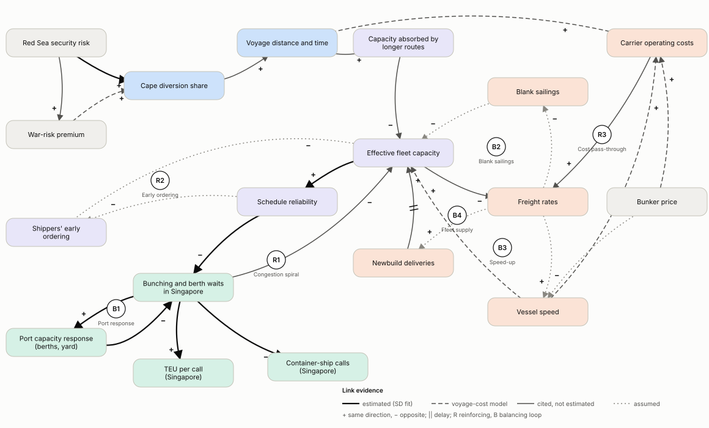
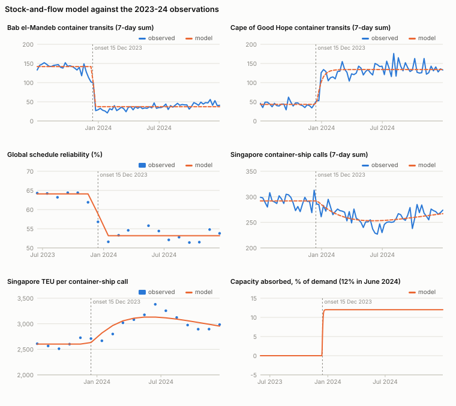
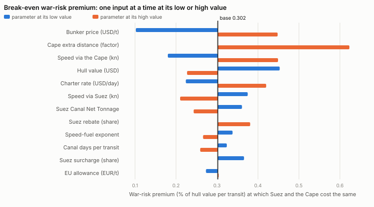
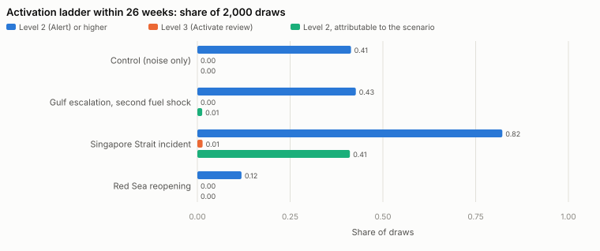

**Abstract.** When container lines left the Suez route in December 2023, the effect reached
Singapore through the capacity that longer voyages absorb and through ships arriving off schedule.
This paper links four parts built only from public data and dated sources. A causal loop diagram
names 27 links and 7 of them are estimated. A stock-and-flow
model, calibrated to 2023-24 transits, schedule reliability and Singapore port data, explains
96% of the variance of Bab el-Mandeb container transits and 66% of that of
Singapore container calls. A voyage-cost model of an Asia-North Europe loop puts the war-risk premium at
which Suez and the Cape cost the same at 0.30% of hull value per
transit, against 1-2% reported in July 2026. Seeded Monte Carlo scenarios, read through the
repository's own alarm detector and activation ladder, show which future disruptions the ladder would
see. A small local language model extracted cause-effect links from 19 public
passages; its agreement with a reference set made by the author's tooling is reported with
intervals.

# 1. Question

The repository this paper extends is a monitor: 17 public indicators, a robust
alarm detector and a three-level activation ladder, backtested on 8 labelled
disruptions. It answers *whether* something is moving. This paper asks *how* the 2023-24 Red Sea
diversion moved through the network, what it costs, and what the monitor would show next time:

1. Which feedback loops connect the diversion to congestion in Singapore and to freight markets,
   and which of those links can public data estimate?
2. How quickly did routing, schedule reliability and Singapore's port respond, and how well does a
   small stock-and-flow model reproduce them?
3. What does the long way round cost a carrier, and at what war-risk premium does Suez become cheaper?
4. Which forward disruptions would reach the monitor's Alert level, how fast, and at what cost?
5. Can a 4-billion-parameter model running on a laptop help map causal claims in public texts?

# 2. Data

All results rebuild offline from files in the repository (`python run_all.py`); network access is
needed only to refresh them. Every hand-entered input carries one of four labels: REAL (with a URL
and access date), ASSUMPTION, ILLUSTRATIVE or SYNTHETIC (70 REAL rows,
52 ASSUMPTION rows across 10 files; `data/PROVENANCE.md`
lists what could not be verified).

- **Monitor data** (IMF PortWatch daily chokepoint transits and port calls; MPA monthly container
  throughput via data.gov.sg), fetched 13 October 2026. Container-ship transits of Bab el-Mandeb and
  the Cape of Good Hope and Singapore container-ship calls are used as non-overlapping weekly sums,
  and TEU per call as MPA throughput divided by PortWatch calls.
- **Schedule reliability.** Eighteen monthly values of Sea-Intelligence's global schedule
  reliability, June 2023 to December 2024 (April 2024 is missing), each taken from its press release.
- **Voyage inputs.** Fuel use from a published 14,000 TEU reference design (MAN Energy Solutions),
  Suez Canal Authority containership toll bands from January 2024 with the 2026 surcharge, the IMF SDR
  rate, the Singapore VLSFO price of early November 2026 (ENGINE), the EEX auction price of an EU
  allowance on 12 November 2026, the ECB euro rate, and war-risk premiums reported by Reuters. The
  charter rate, the ship's net tonnage and hull value, auxiliary fuel and port times are assumptions.
- **Text corpus.** 19 passages from UNCTAD's *Review of Maritime Transport 2024*
  (chapters II and III, CC BY 3.0 IGO), two MPA statements and an MOT parliamentary reply. Their terms
  do not allow republication, so only hashes, anchor phrases and quotes of at most 14 words are kept.

# 3. Methods

**Causal loop diagram.** Eighteen variables and 27 signed links, each tagged by its
evidence: *estimated* by the stock-and-flow calibration, implied by the voyage *model*, *cited* from a
published source without being estimated here, or *assumed*. Feedback loops are all simple cycles of
the link graph; a loop reinforces when the product of its signs is positive.

**Stock-and-flow model.** Seven stocks integrated daily with the package's own fourth-order
Runge-Kutta scheme (tested against analytic step responses): the diverted share *D* of pre-crisis
Bab el-Mandeb container transits, which approaches *d*~max~ after the onset with time constant
*τ*~d~; a Cape pipeline that follows *D* with delay *τ*~c~; the capacity absorbed by longer routes, *A*,
which follows *D* with delay *τ*~a~; schedule unreliability *U = u*~0~ + *βA* (with response time
*τ*~u~ fixed at one day); Singapore bunching *Q*, which builds from *U − u*~0~ and is removed by an
adaptation stock *K* (berths, yards, schedule coordination) with a common time constant *τ*~q~; and a
network-position stock used only in scenarios. Observations are Bab el-Mandeb transits *B*~0~(1 − *D*),
Cape transits *C*~0~ + *κB*~0~*D*~c~, reliability 1 − *U*, Singapore calls *C*~b~(1 − *θ*~c~*Q*) and TEU per
call *T*~b~(1 + *θ*~t~*Q*). Baselines are pre-crisis means. Calibration runs block by block in causal
order (routing, reliability, Singapore), solving linear parameters in closed form and the others by
bounded Nelder-Mead or golden-section search; the onset day is profiled. Standard errors come from
the Gauss-Newton covariance with one residual variance per series, inflated by (1 + *ρ*)/(1 − *ρ*) for
lag-1 residual autocorrelation *ρ*. A model with known parameters, plus noise, is recovered by the
same code in the test suite.

**Voyage economics.** A Shanghai-Ningbo-Yantian-Singapore-Rotterdam-Hamburg-Antwerp-Singapore loop
for a 14,000 TEU ship, with sea distances from `searoute` (within 2% of UNCTAD's
Shenzhen-Rotterdam figures, but 27% short of the Cape detour given by Notteboom et al., 2024, which the
sensitivity analysis carries). Costs per round voyage: main-engine fuel scaled from the reference
point by (speed ratio)^3^ and by calorific value, auxiliary fuel, charter hire for the voyage days,
Suez tolls (two laden transits), the war-risk premium on hull value (two transits of the high-risk
area) and EU allowances for 50% of the emissions of voyages to or from the EU and 100% within and
between EU ports (European Commission, 2026). Suez is costed at 16 knots and the Cape at 17, following
Notteboom et al. (2024). The premium enters linearly, so the break-even premium is exact; each other
input is moved alone to its low and high value for the tornado.

**Scenarios.** 2,000 seeded draws per scenario over 26 weeks from 5 October 2026: a Gulf escalation
with a second fuel shock, a Singapore Strait incident, and a Red Sea reopening driven through the
calibrated model. Each indicator starts at the detector's baseline at the data cut-off, with
detrended 2025 noise resampled in 28-day blocks; every scenario uses the same noise as a noise-only
control, so its increment over the control on the same draw is attributable to its shock. Paths go
through the selected detector (z ≥ 2.5 for 3 days, against
the cut-off baseline), the publication lags and the ladder. Re-running the repository's own detector on
real history plus simulated paths agrees on 99.4% or more of
breach days.

**Language-model extraction.** A 17-variable codebook (`data/corpus/codebook.md`) defines when a
sentence states a link and how to sign it. The reference set (45 links) was
labelled with the codebook by the author's tooling, not by independent human annotators. The models
ran locally through Ollama with temperature 0, a fixed seed and JSON-schema output, prompted with the
codebook verbatim. A prediction counts when the same directed pair is in the reference set for the
same passage; intervals come from 2,000 bootstrap resamples of passages.

# 4. Results

## 4.1 Structure

Of the 27 links, 7 are estimated, 5
follow from the voyage model, 8 are cited and 7
are assumed. Of the seven loops, only the port-response loop (B1) is estimated end to end. The
congestion spiral (R1) rests on two estimated links and one cited link; the freight-market loops (B2,
B3, B4, R3) contain assumed links because the repository has no freight-rate series, which is where
interviews and a workshop can add most (`workshop/`).

## 4.2 Calibration

| Series | n | R² | MAPE % |
| --- | ---: | ---: | ---: |
| Bab el-Mandeb container transits (weekly) | 79 | 0.96 | 13.8 |
| Cape container transits (weekly) | 79 | 0.91 | 10.6 |
| Global schedule reliability (monthly, %) | 18 | 0.93 | 2.0 |
| Singapore container calls (weekly) | 79 | 0.66 | 3.3 |
| Singapore TEU per call (monthly) | 18 | 0.82 | 2.9 |

| Parameter | Block | Estimate | 95% interval | Meaning |
| --- | --- | --- | --- | --- |
| `t0` | routing | 2023-12-14 | 2023-11-30 to 2023-12-16 | Onset of the diversion; data/events.csv documents 2023-12-15 |
| `d_max` | routing | 0.738 | 0.717 to 0.759 | Diverted share of the pre-crisis Bab el-Mandeb container transits |
| `tau_d` | routing | 1.34 | 0 to 3.06 | Routing adjustment time |
| `tau_c` | routing | 12.7 | 5.65 to 19.8 | Delay before diverted ships appear at the Cape |
| `kappa` | routing | 0.869 | 0.819 to 0.918 | Cape container transits gained per Bab el-Mandeb transit lost |
| `beta` | reliability | 0.148 | 0.131 to 0.165 | Unreliability (share of late arrivals) per unit of absorbed capacity |
| `tau_q` | singapore | 166 | 131 to 201 | Bunching build-up time = adaptation time (tau_k tied to tau_q) |
| `theta_c` | singapore | 3.31 | 2.84 to 3.79 | Relative fall in Singapore container calls per unit of bunching |
| `theta_t` | singapore | 5.08 | 4.07 to 6.09 | Relative rise in TEU per call per unit of bunching |
| `tau_a` | reliability | 1 | 1 to 10 | Delay between diversion and absorbed capacity (carries the whole routing-to-reliability delay) |

The profiled onset is 2023-12-14 (95% range 2023-11-30 to 2023-12-16); the
carriers' pause documented in the event list began on 15 December 2023. Routing changed within days
and settled with 74% of the pre-crisis Bab el-Mandeb container traffic diverted;
0.87 Cape transits appeared for each lost Bab el-Mandeb transit, about
13 days later. Global reliability fell with no measurable delay: the absorption
delay sits at the bottom of its search range, and the profile rejects delays above about
10 days. Holding it at one Asia-Europe voyage (30 days) worsens the
reliability fit (RMSE 2.28 against 1.36 percentage
points). This is consistent with reliability falling as soon as ships were out of position, rather
than gradually as absorbed capacity built up; the data cannot separate the two delays, so the model
reports them as one. Singapore's response took longer: bunching built and faded with a time constant of
166 days (95% interval 131 to 201). The
smooth model under-states the peaks: it lowers calls by at most 13.3% and raises
TEU per call by at most 20.3%, against 22.2% and
29.9% at the observed extremes. Residuals are autocorrelated (*ρ* up to
0.43), and the intervals are inflated for it.

## 4.3 Voyage economics

| Per round voyage | Via Suez | Via the Cape |
| --- | ---: | ---: |
| Round-voyage days | 66.8 | 78.5 |
| Ships for a weekly service | 9.5 | 11.2 |
| Fuel burnt (t) | 4,093 | 5,995 |
| Fuel (USD) | 3,642,599 | 5,335,215 |
| Charter (USD) | 4,005,203 | 4,710,838 |
| Suez tolls (USD) | 1,774,109 | 0 |
| War-risk premium at 1% (USD) | 3,000,000 | 0 |
| EU ETS (USD) | 521,090 | 803,715 |
| Total (USD) | 12,943,001 | 10,849,769 |
| Per TEU carried (USD) | 616.33 | 516.66 |

The Cape loop takes 78.5 days against 66.8, needs
1.7 more ships for a weekly service (Notteboom et al., 2024, report at least
two for a typical loop) and burns 1,902 t more fuel per round voyage. Suez saves that
fuel, charter time and some EU allowances but pays 887,055 USD per
transit in tolls and the war-risk premium twice. Suez is cheaper only below
0.30% of hull value per transit (453,384
USD on a 150 million USD hull). At the 1% reported for the southern Red Sea at the end of July 2026
(Reuters via Insurance Journal, 2026) the Cape is cheaper by 100 USD
per TEU carried. The break-even is most sensitive to the bunker price
(0.10-0.45%), the length of the
Cape detour (0.30-0.62%) and the
speed on the Cape route (0.18-0.45%).
Costs that arise only on the Suez routing and are outside the model, such as crew bonuses for the
high-risk area or war-risk cover on cargo (not verified here), would lower the break-even further, and
crew safety is not priced at all.

## 4.4 Scenarios

| Scenario | P(Alert) | P(Alert) due to the scenario | P(Activate review) | Median days, onset to Alert |
| --- | ---: | ---: | ---: | ---: |
| Control (noise only) | 0.41 | 0.00 | 0.00 | - |
| Gulf escalation, second fuel shock | 0.43 | 0.01 | 0.00 | 79 |
| Singapore Strait incident | 0.82 | 0.41 | 0.01 | 11 |
| Red Sea reopening | 0.12 | 0.00 | 0.00 | - |

Noise alone reaches Alert in 41% of draws, which is why the
attributable column matters. A Singapore Strait incident is the disruption the ladder is built for: it
adds an Alert in 41% of draws, a median
11 days after the incident, because Malacca transits and
Singapore calls fall together; waiting ships cost a median 48
million USD (5-95%: 8-221).
A second Gulf fuel shock adds a median 99 USD per TEU to
the Cape loop (5-95%: 61-138)
but adds an Alert in only 1.4% of draws: the monitor has no
price indicator, and Hormuz traffic, already re-baselined after its 2026 collapse, cannot fall far. A
Red Sea reopening adds no alarms at all, because the route detectors only look for falls in
Bab el-Mandeb and Suez traffic and rises at the Cape; the calibrated model predicts relief in Singapore,
and Suez is cheaper than the Cape in 37% of draws. The noise model
over-alarms on Suez and Bab el-Mandeb and never alarms on Malacca or the port indicators
(`outputs/maritime/scenario_noise_check.csv`), so the absolute shares carry that bias.

## 4.5 Language-model extraction

| Model | Links | Matched | Precision (95% CI) | Recall (95% CI) | F1 | Polarity agreement | Verbatim quotes |
| --- | ---: | ---: | ---: | ---: | ---: | ---: | ---: |
| `gemma3:4b` | 38 | 20 | 0.53 (0.38-0.68) | 0.44 (0.33-0.55) | 0.48 | 0.90 | 0.95 |
| `llama3.2:3b` | 96 | 15 | 0.16 (0.06-0.32) | 0.33 (0.16-0.46) | 0.21 | 1.00 | 0.99 |
| `qwen3.5:4b` | 42 | 25 | 0.60 (0.45-0.70) | 0.56 (0.42-0.67) | 0.57 | 1.00 | 0.98 |

The reference set has 45 links in 19 passages.
`qwen3.5:4b` proposed 42 links, of which
25 match the reference: precision 0.60
(95% interval 0.45-0.70) and recall 0.56
(0.42-0.67), with the reference's sign on
100% of the matched links and
98% of its evidence quotes found verbatim in the passage.
`gemma3:4b` reached 0.53 and 0.44.
`llama3.2:3b` reached only 0.16 and
0.33: it listed 96 links,
and on 2 passages its output ran into the 1,024-token cap twice
and was scored as no links. Temperature 0 and a fixed seed did not make the runs exactly repeatable: two
runs of `qwen3.5:4b` shared 41 of 43
distinct links (`outputs/maritime/extraction_repeat.csv`). The intervals are wide because there are only
19 passages. The disagreements are of two kinds (`outputs/maritime/extraction_errors.csv`):
links the codebook requires but a model missed, most often the effect of off-schedule arrivals and of
port capacity on berth waiting; and readings the single reference labeller did not choose but that are
defensible, such as freight rates driving consumer prices where the reference attributes the rise in
prices to the disruption itself. The second kind is a reason to add an independent human labeller
before these figures are used as a benchmark.

# 5. Limitations

- **One episode.** The model is calibrated to one diversion. Its Singapore block is linear and
  symmetric, so the predicted relief on reopening is an extrapolation, and the re-routing friction is an
  assumption, not an estimate.
- **Global, not route-level, reliability.** The reliability index covers all trades; the model treats
  its 2024 fall as caused by the Red Sea alone.
- **No freight rates.** Free historical freight-rate indices cannot be redistributed, so every link
  into or out of rates is cited or assumed.
- **Representative costs.** One ship, one loop, one bunker price; the charter rate, net tonnage and
  hull value are assumptions, and costs outside the carrier's voyage account are left out.
- **Scenario design.** Scenarios start from a quiet baseline rather than from the Level 3 posture at the
  cut-off, the noise model reproduces per-indicator false-alarm rates only roughly, and every
  distribution is an assumption with stated anchors.
- **One labeller.** The extraction reference set is one reading by the author's tooling; agreement with
  it is not accuracy, and 19 passages give wide intervals.

# 6. Conclusion

Public data identify the first half of the chain well (routing, the Cape pipeline and the fall in
schedule reliability) and the Singapore episode adequately, and they show that reliability fell at once
while Singapore took months to bunch and recover. They say nothing direct about freight rates, which is
where the diagram rests on citations and assumptions. On costs, the Cape stays cheaper while war-risk
premiums exceed about 0.3% of hull value per transit. On monitoring,
the activation ladder is well suited to sudden local losses of throughput, blind to price shocks, and
by design silent about recoveries; a bunker-price indicator and a schedule-reliability series would
close the first gap. The next steps are a same-season baseline for the detector, the interview and
workshop programme in `workshop/`, and a second labeller for the extraction set.

# References

European Central Bank (2026). Euro foreign exchange reference rates, 13 November 2026. https://www.ecb.europa.eu/stats/eurofxref/eurofxref-daily.xml (accessed 15 Nov 2026).

European Commission (2026). Reducing emissions from the shipping sector (page last updated 6 May 2026). https://climate.ec.europa.eu/eu-action/transport-decarbonisation/reducing-emissions-shipping-sector_en (accessed 15 Nov 2026).

EEX (2026). EU ETS primary market auction report 2026 (workbook). https://public.eex-group.com/eex/eua-auction-report/emission-spot-primary-market-auction-report-2026-data.xlsx (accessed 15 Nov 2026).

ENGINE (2026). Singapore's VLSFO price falls below $900/mt to around $890/mt, 4 November 2026. https://engine.online/news/singapores-vlsfo-price-falls-below-usd900-mt-to-around-usd890-mt-839c (accessed 15 Nov 2026).

ENGINE via Hellenic Shipping News (2026). Suez Canal Authority suspends container ship rebate, 8 April 2026. https://www.hellenicshippingnews.com/suez-canal-authority-suspends-container-ship-rebate/ (accessed 15 Nov 2026).

Halili, G. (2025). searoute 1.6.0 (Python package). https://pypi.org/project/searoute/1.6.0/ (accessed 15 Nov 2026).

IMF (2026). SDR valuation, rates as of 13 November 2026. https://www.imf.org/external/np/fin/data/rms_sdrv.aspx (accessed 15 Nov 2026).

IMF PortWatch (2026). Daily chokepoint transit and port call data. https://portwatch.imf.org/ (fetched 13 Oct 2026).

IMO (2022). Resolution MEPC.364(79), 2022 Guidelines on the method of calculation of the attained EEDI for new ships. https://wwwcdn.imo.org/localresources/en/KnowledgeCentre/IndexofIMOResolutions/MEPCDocuments/MEPC.364(79).pdf (accessed 15 Nov 2026).

Leth Agencies (2026). Newsletter, 10 June 2026. https://lethagencies.com/1203 (accessed 15 Nov 2026).

Lloyd's List via Kuehne+Nagel (2025). Suez Canal Authority extends container ship rebate, 5 August 2025. https://mykn.kuehne-nagel.com/news/article/suez-canal-authority-extends (accessed 15 Nov 2026).

MAN Energy Solutions (n.d.). Propulsion of 14,000 teu container vessels. https://www.man-es.com/docs/default-source/marine/tools/propulsion-of-14-000-teu-new-panamax-container-vessel.pdf?sfvrsn=58b2c2_14 (accessed 15 Nov 2026).

Maritime and Port Authority of Singapore (2024a). Media statement on vessels' extended waiting times for berths in the Port of Singapore, 30 May 2024 (accessed 15 Nov 2026).

Maritime and Port Authority of Singapore (2024b). MPA to permit night movement of line-towed container barges at Pasir Panjang Terminal, 4 September 2024 (accessed 15 Nov 2026).

Ministry of Transport, Singapore (2024). Written reply to Parliamentary Question on adequacy of Singapore's seaports to anticipate and manage severe cargo congestion, 2 July 2024 (accessed 15 Nov 2026).

Notteboom, T., Haralambides, H. and Cullinane, K. (2024). The Red Sea Crisis: ramifications for vessel operations, shipping networks, and maritime supply chains. *Maritime Economics & Logistics* 26, 1-20. https://doi.org/10.1057/s41278-024-00287-z

Reuters via Insurance Journal (2026). Houthis' Red Sea attacks prompt London insurers to widen high-risk zone, 30 July 2026. https://amp.insurancejournal.com/news/international/2026/07/30/879653.htm (accessed 15 Nov 2026).

Sea-Intelligence (2023-2025). Global Liner Performance press releases, July 2023 to January 2025; one URL per month in `data/inputs/schedule_reliability_glp.csv` (accessed 15 Nov 2026).

Suez Canal Authority (2023). "Transit Dues Rates" schedules applicable from the 15th of January 2024 (copy hosted by ISS). https://www.iss-shipping.com/wp-content/uploads/2023/10/Transit-Dues-Rates-Schedules.pdf (accessed 15 Nov 2026).

UNCTAD (2024). *Review of Maritime Transport 2024: Navigating maritime chokepoints*, chapters II and III. United Nations, Geneva. https://unctad.org/publication/review-maritime-transport-2024 (accessed 15 Nov 2026).

Veson Nautical via Hellenic Shipping News (2026). Bunkering at $1,000/MT: what I'm telling clients right now, 14 April 2026 (accessed 15 Nov 2026).

VesselsValue via Hellenic Shipping News (2026). Weekly vessel valuations report, 20 January 2026 (accessed 15 Nov 2026).
